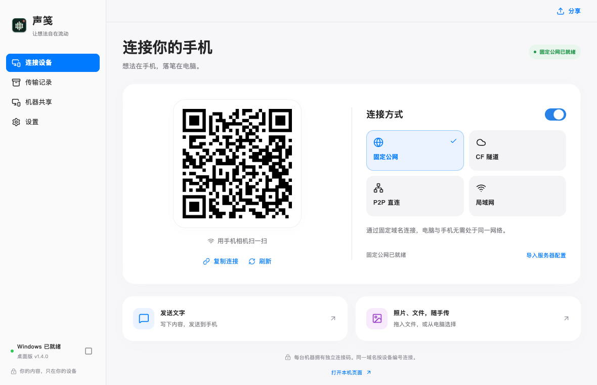

# 声笺 Windows 桌面端

[项目首页](../README.md) · [开发与构建](../docs/DEVELOPMENT.md) · [CI 说明](../docs/CI.md)

桌面壳使用 Tauri 2、React 和 TypeScript，Python Sidecar 继续提供局域网手机页面、剪贴板与历史数据服务。

## 界面与 Mac 对齐

默认进入“连接设备”，侧栏统一为连接设备、传输记录、机器共享和设置。首页采用 Mac 相同的二维码与连接方式双栏卡片、蓝色主色、浅灰背景和底部文字／文件分享入口；传输记录、设置和机器共享在主窗口内显示。支持系统深色模式、减弱动态效果和键盘焦点。

Windows 继续使用系统标题栏、托盘和原生文件选择器。`Ctrl+1` 至 `Ctrl+4` 切换页面，`Ctrl+,` 打开设置，`Ctrl+N` 分享内容，`Esc` 关闭弹窗。

## 前端验证

`npm run build` 检查 TypeScript 并构建前端，`npm run lint` 执行静态检查。

启动 `npm run dev -- --host 127.0.0.1 --port 1420` 后，可从仓库根目录运行 `node scripts/smoke_desktop_ui.cjs`。脚本需要可用的 Playwright；用 `SHENGJIAN_PLAYWRIGHT_MODULE` 指定已有模块路径，`SHENGJIAN_UI_BROWSER` 指定已安装的 Chromium／Chrome。可选的 `SHENGJIAN_UI_URL` 和 `SHENGJIAN_UI_OUTPUT` 分别指定预览地址和输出目录。

此检查拦截原生 IPC 和桌面 API，使用隔离示例数据验证导航、连接切换、二维码刷新、分享、错误保留草稿、历史搜索、机器邀请和快捷键，截图默认保存在 `build/windows-ui-check/`。它不连接真实手机、不操作本机数据，也不能代替 Windows 安装包和真机验证。

开发：`npm run tauri dev`

完整构建：`..\scripts\build_tauri.ps1`

“机器共享”支持 Mac / Windows 一次性邀请配对、公网或局域网双向文件传输、进度和 SHA256 校验。Mac 1.2.0 的共享协议兼容本版。

Windows 构建需要 Python 3.12、Node.js 24、Rust/MSVC 和官方 cloudflared.exe。安装 `requirements-windows.txt`；将 Cloudflare 官方 2026.10.2 的 Windows amd64 二进制放入 `tools/cloudflared/cloudflared.exe`，或通过 `-Cloudflared` 指定。构建脚本同时生成 Tauri NSIS 安装版与 Qt 便携版，二者都内置隧道程序。仓库 Windows Actions 会验证下载摘要、运行测试、构建并上传安装包附件。
