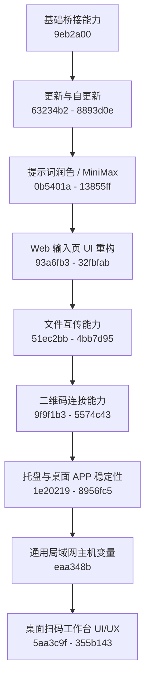

# Git 提交版本可视化报告

生成时间：2026-07-04  
当前分支：`master`  
当前版本：`0.5.26`  
统计基准提交：`355b143 Hide activity log from desktop first screen`  
功能演进提交数：`32`  
说明：本报告统计口径不含“新增本报告”这一文档提交。

## 一图看懂



## 版本演进时间线

```mermaid
gitGraph
    commit id: "9eb2a00 初始桥接"
    commit id: "63234b2 更新检测"
    commit id: "0b5401a 本地提示词库"
    commit id: "f98386a MiniMax API"
    commit id: "b5175f8 重建后重启"
    commit id: "79a8c12 一键自更新"
    commit id: "8893d0e 本地更新源"
    commit id: "58b2570 MiniMax Key 修复"
    commit id: "4ad4015 润色范围约束"
    commit id: "13855ff 润色确认流"
    commit id: "93a6fb3 Web UI 重构"
    commit id: "ba74cb6 移除网络状态"
    commit id: "32fbfab 紧凑输入页"
    commit id: "51ec2bb 文件上传桥"
    commit id: "a5c97e4 纸纹背景"
    commit id: "7233401 现代上传控件"
    commit id: "0224bf6 手机文件流"
    commit id: "7e86f5a 移除高度滑条"
    commit id: "99d176c 拆分文件选择"
    commit id: "4bb7d95 发送时粘贴文件"
    commit id: "9f9f1b3 二维码入口"
    commit id: "5574c43 qrcode 库"
    commit id: "1e20219 托盘支持"
    commit id: "0d25c4c 定制图标"
    commit id: "807264f 托盘诊断"
    commit id: "8956fc5 关闭保活"
    commit id: "eaa348b 主机变量"
    commit id: "5aa3c9f 服务状态 UX"
    commit id: "f5748ef 扫码工作台"
    commit id: "9dbbc23 简化控制"
    commit id: "1b8cece 工作台布局优化"
    commit id: "355b143 隐藏活动日志"
```



## 阶段划分

| 阶段 | 提交范围 | 主要成果 | 当前价值 |
|---|---:|---|---|
| 1. 基础桥接 | `9eb2a00` | 初始 Web 服务、中文转英文按钮、剪贴板粘贴链路 | 软件可用的起点 |
| 2. 更新体系 | `63234b2` - `8893d0e` | 检查更新、本地更新源、一键自更新、重建后重启 | 可以持续迭代和分发 |
| 3. 提示词润色 | `0b5401a` - `13855ff` | 本地提示词库、MiniMax-M3 调用、确认式润色流程 | 输入页从“粘贴工具”升级为“提示词工作台” |
| 4. Web UI | `93a6fb3` - `32fbfab` | Web 输入页视觉重构、隐藏网络信息、紧凑输入框 | 手机端更适合单屏使用 |
| 5. 文件互传 | `51ec2bb` - `4bb7d95` | 文件上传、手机文件选择优化、多文件发送后粘贴 | 支持文字、图片、文档互传 |
| 6. 二维码连接 | `9f9f1b3` - `5574c43` | 移除长地址栏、生成可扫码二维码、使用成熟 qrcode 库 | 手机连接门槛降低 |
| 7. 桌面稳定性 | `1e20219` - `8956fc5` | 托盘图标、关闭保活、托盘诊断、定制图标 | 更像常驻桌面软件 |
| 8. 泛化分发 | `eaa348b` | 局域网主机变量从固定 IP 改为运行时自动识别 | 别人电脑也能复用 |
| 9. 桌面 UI/UX | `5aa3c9f` - `355b143` | 状态卡、扫码工作台、单按钮服务控制、日志默认收起 | 当前主体验版本 |

## 最近 10 个关键提交

| 提交 | 日期 | 说明 |
|---|---|---|
| `355b143` | 2026-07-04 | 隐藏首屏最近活动日志，避免暴露本机绝对路径 |
| `1b8cece` | 2026-07-04 | 左侧改为连接步骤，二维码标题更短，二维码更大 |
| `9dbbc23` | 2026-07-04 | 隐藏局域网地址/端口信息卡，服务启停合并为一个按钮 |
| `f5748ef` | 2026-07-04 | 桌面 APP 重构为扫码工作台 |
| `5aa3c9f` | 2026-07-04 | 强化服务状态提示，解决启动成功提示不显眼 |
| `eaa348b` | 2026-07-04 | 扫码链接主机改为变量，支持其他电脑复用 |
| `8956fc5` | 2026-07-04 | 关闭窗口时保持托盘运行 |
| `807264f` | 2026-07-04 | 增加托盘生命周期诊断 |
| `0d25c4c` | 2026-07-04 | 添加定制 APP 图标 |
| `1e20219` | 2026-07-04 | 添加 Windows 系统托盘支持 |

## 可回滚参考点

| 目标 | 建议回滚到 | 说明 |
|---|---|---|
| 保留 Web 功能但撤回桌面扫码工作台 | `5aa3c9f` 前后对比 | 用于比较桌面 UI 重构前后的状态 |
| 撤回托盘相关能力 | `1e20219` 之前 | 会失去关闭保活和托盘菜单 |
| 撤回文件互传 | `51ec2bb` 之前 | 会退回文字/提示词为主的版本 |
| 撤回 MiniMax 润色 | `f98386a` 之前 | 会失去大模型提示词润色 |
| 回到最初桥接版本 | `9eb2a00` | 只适合做历史参考，不建议实际回退 |

## 当前分发建议

当前推荐分发文件：

```text
dist/DoubaoLanInputBridge_zh2en.exe
```

不要一起分发以下本机运行数据：

```text
%LOCALAPPDATA%\DoubaoLanInputBridge
run_data*
local_update_source
任何包含 API Key 或访问 Key 的文件
```

这些数据应由每台电脑首次运行时自行生成或单独配置。
